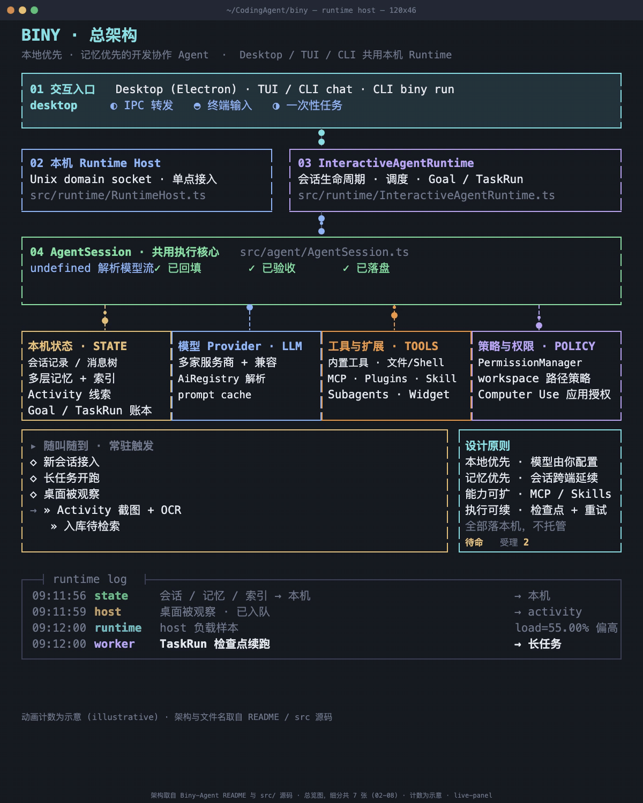

# Biny

**本地优先、记忆优先的开发协作 Agent，提供 macOS Desktop、TUI 与 CLI。**

Biny 帮你在本地项目中对话、处理开发任务，并把会话和记忆带到后续工作中。模型由你配置，工具与工作流可通过 MCP、插件和 Skills 扩展。

[GitHub](https://github.com/binyouo/Biny-Agent) · [Issues](https://github.com/binyouo/Biny-Agent/issues)

## 架构



Desktop、TUI 与 CLI chat 共用本机 Runtime Host；`biny run` 提供一次性任务入口。会话与记忆保存在本机。

动画中的状态、日志与计数为示意值。可查看 [静态图](architecture-panels/assets/overview.png)，模块职责与数据流见 [架构说明](docs/ARCHITECTURE.md)。

## 核心能力

| 能力 | Biny 提供 |
| --- | --- |
| 人格与成长 | 自定义性格与表达方式，记住你的称呼和偏好，通过日记与自省积累新的兴趣、观点和习惯。 |
| 情绪与作息 | 基础心情、对话情绪与疲劳状态共同影响语气和回应方式，支持入睡、唤醒与休息。 |
| 记忆与巩固 | 结合会话、项目上下文与长期记忆延续协作，并在空闲时去重、归档过期事实和合并相关记忆。 |
| 多端交互 | 通过 macOS Desktop、终端 TUI 或 CLI chat 对话，也可用 `biny run` 执行脚本化的一次性任务。 |
| 桌面活动记录 | 记录应用活动、画面与 OCR 线索，支持回看、检索、活动摘要和工作日记。 |
| 长任务与自动化 | 保存目标与进度，支持任务拆分、检查点续跑、完成验证与定时执行；开启心跳后可按清单巡检。 |
| 文件、浏览器与电脑操作 | 读写项目文件、执行受控命令、操作内置浏览器，并在授权后观察和操作 macOS 应用。 |
| 交互式可视化 | 在 Desktop 对话中生成可交互的 HTML/SVG 图表与页面，也可导出独立页面。 |
| 模型与扩展 | 自选模型服务商或 OpenAI-compatible 接口，通过 MCP、Plugins、Skills 和子代理扩展工具与工作流。 |
| 自拍与虚拟旅行 | 按设定外观生成自拍、管理相册，并用虚拟旅行记录想象中的见闻与日记。 |

## 快速开始

macOS 用户可在 [Releases](https://github.com/binyouo/Biny-Agent/releases) 下载 App：Apple Silicon 选择 `arm64`，Intel 选择 `x64`；打开 DMG 后将 Biny 拖入 Applications。

首版 Beta 未使用 Apple Developer ID 签名或公证。首次打开可能被 macOS 拦截；确认下载来源后，可在“系统设置 → 隐私与安全性”中选择“仍要打开”，详见 [Apple 的说明](https://support.apple.com/en-us/102445)。

### 从源码运行

需要 Node.js 与 pnpm `10.6.5`。克隆仓库并初始化：

```bash
git clone https://github.com/binyouo/Biny-Agent.git
cd Biny-Agent
corepack enable
corepack prepare pnpm@10.6.5 --activate
pnpm install --frozen-lockfile
pnpm dev -- init
```

完成 [模型配置](docs/CONFIGURATION.md) 后，启动终端对话或 Desktop：

```bash
pnpm dev -- chat
pnpm desktop:dev
```

CLI 帮助：`pnpm dev -- --help`。

## 文档

完整阅读入口见 [文档索引](docs/README.md)。

- [CLI 使用指南](docs/CLI_USAGE.md) — 命令地图、配置、会话、项目、预览与终端操作。
- [docs/CONFIGURATION.md](docs/CONFIGURATION.md) — 服务商、模型别名、凭据与项目设置。
- [隐私脱敏](docs/PRIVACY.md) — 发送前替换、回复还原，以及缓存与本地数据边界。
- [docs/SESSIONS.md](docs/SESSIONS.md) — 对话入口、会话恢复、分支与导入导出。
- [docs/IMPORTS.md](docs/IMPORTS.md) — 从其他应用导入模型、MCP 与会话，管理同步和历史。
- [docs/MEMORY.md](docs/MEMORY.md) — 长期事实的写入、召回、整理与管理。
- [docs/PERMISSIONS.md](docs/PERMISSIONS.md) — 工具权限模式、沙箱与应用授权边界。
- [docs/EXTENSIONS.md](docs/EXTENSIONS.md) — MCP、Skills、Plugins 与子代理。
- [docs/BROWSER.md](docs/BROWSER.md) — 内置浏览器与 Chrome 标签连接。
- [docs/COMPUTER_USE.md](docs/COMPUTER_USE.md) — macOS 权限、应用审批、窗口镜像与外部 MCP。
- [docs/ACTIVITY.md](docs/ACTIVITY.md) — 桌面采集、OCR、活动分析、工作日记与 Appshots。
- [docs/AUTOMATION.md](docs/AUTOMATION.md) — 会话目标、任务图与定时执行。
- [docs/ARCHITECTURE.md](docs/ARCHITECTURE.md) — 运行链路、模块职责与本地状态。
- [docs/EVALUATION.md](docs/EVALUATION.md) — 实现检查、模型评测与成绩口径。

## 贡献与安全

- [CONTRIBUTING.md](CONTRIBUTING.md) — 开发环境、构建、验证与文档维护。
- [工具与权限](docs/PERMISSIONS.md) — 文件、命令、扩展和桌面控制的安全边界。
- [Issues](https://github.com/binyouo/Biny-Agent/issues) — 问题反馈与功能请求。
- [第三方声明](THIRD_PARTY_NOTICES.txt) — 第三方依赖的版权与许可证说明。
