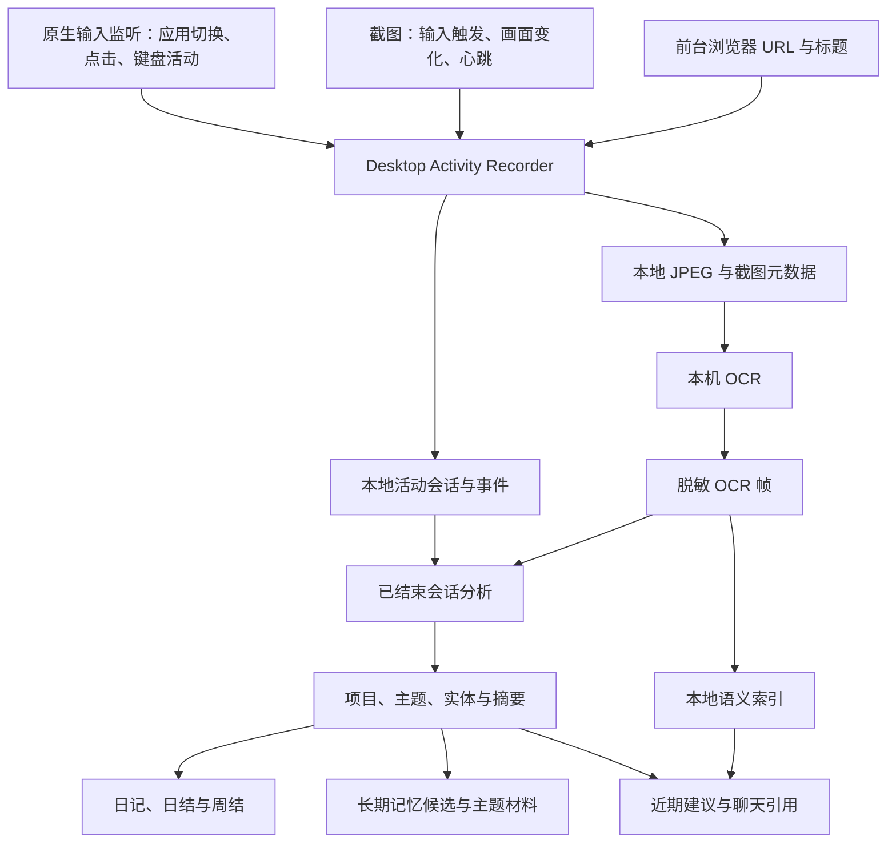

# 活动记录与 Appshots

Biny 的 Activity 模块将本机桌面操作记录为可回溯的会话，从屏幕文字与交互事件中提取工作上下文、项目主题与操作线索，用于查找历史资料、自动生成工作日报与周结，以及为聊天提供近期背景。

Appshots（窗口快照）则提供独立的快捷键，用于抓取当前应用窗口并把截图与可读取的界面文字直接送入聊天草稿中，不依赖持续的后台活动采集。

## 数据流转链路



* **管理与调度**：采集与分析由 Desktop 主进程中的 `ActivityRecorderService` 管理，原生子进程负责轻量监听、截图与 OCR。
* **CLI 支持**：CLI 查询与报告直接复用本地存储与领域模块；`activity start` 与 `stop` 切换配置，实际采集依赖 Desktop 运行。

## 记录内容与活动会话边界

| 数据类型 | 保存内容与实际作用 |
| --- | --- |
| **输入事件** | 应用切换、鼠标点击、键盘操作计数、锁屏与解锁等时间锚点（键盘仅记录键码与计数，**不记录字符正文**）。 |
| **浏览器事件** | 前台 Safari、Chrome、Edge 的当前标签 URL 与标题（自动剔除 URL 登录信息、参数与哈希片段）。 |
| **桌面截图** | 本地 JPEG 图片，记录捕获时间、目标应用、窗口尺寸与触发原因。 |
| **OCR 文本帧** | 截图提取文字，写入前经过本地规则脱敏；异步完成识别后与截图关联。 |
| **会话分析报告** | 归纳出的项目、标题、主题，以及识别到的 PR、代码提交、人物、版本与工作线索。 |

### 活动会话（Activity Session）定义

- **独立边界**：这里的活动会话是一段连续的桌面活动（区别于聊天会话）。
- **会话流转**：首次有效事件或截图触发会话创建；默认连续空闲 30 秒或锁屏时自动结束会话。浏览器轮询与截图心跳仅附着于当前活跃会话，不单方面无限延长空闲计时。
- **采集去重防抖**：捕获会去抖，并通过缩略图直方图和像素差异过滤重复画面；默认心跳 120 秒，画面与浏览器轮询间隔 12 秒，OCR 默认每 3 帧处理 1 次。

### 应用黑名单排除

在「设置 → Computer History → 不记录的应用」中配置：
- 支持基于 macOS Bundle ID 准确匹配排除目标应用。
- 排除应用处于前台时，立即停止活动记录与屏幕截图。
- 排除规则仅作用于目标应用本身，不遮挡全屏截图中背景里露出的其他可见窗口。

## 后台分析与记忆沉淀

分析器对已结束的活动会话进行结构化总结：
- **脱敏文本输入**：仅将脱敏后的交互事件与 OCR 文本提供给 `toolModel`（不发送截图原图至模型）。
- **节流与合并**：应用启动 2 分钟后首次巡检，之后每 10 分钟处理待分析会话（有用户前台活跃时跳过）。间隔 ≤5 分钟且应用有重叠的相邻会话会自动合并，微小琐碎操作直接标为琐碎，不发起模型请求。
- **记忆沉淀关联**：有价值的分析会提出长期记忆候选并加入主题沉淀；分析结果落库与记忆写入分立，失败不回滚分析，详见 [长期记忆](MEMORY.md)。
- **失败重试**：模型欠费或网络异常后，执行 `biny activity retry-failed` 可将失败记录重新排队等待空闲时重试。

## 检索、报告与日报生成

| CLI 入口 | 实际读取与输出方式 |
| --- | --- |
| `activity sessions` / `show` | 查看历史活动会话、截图元数据与分析详情。 |
| `activity search` | 在本地活动 OCR 文本中进行关键词精确匹配。 |
| `activity search semantic` | 使用本地 `multilingual-e5-small` 检索 OCR 向量（离线可用）。 |
| `activity digest` | 汇总当前会话、今日耗时与近期已分析项目（不消耗大模型）。 |
| `activity report today` | 读取今日分析生成日记骨架；传 `--narrative` 调用模型生成自然语言叙事。 |
| `activity summary daily / weekly` | 聚合应用时长、活动峰值与关键时刻（支持日结与周结）。 |

- **日报生成策略**：默认只在来源未改变时复用缓存；会话分析更新或重新分析后，再次读取自动重建日报。
- **聊天建议与问候**：新建聊天时可基于近 48 小时的活动分析生成近期建议；纯问候可自然提及近期项目，不虚构未发生的行为。

## 存储、清理与数据安全

- **本地存储**：数据（会话、事件、OCR、分析、摘要）统一存放在全局 `agent.sqlite` 数据库中。
- **截图目录与轮换**：JPEG 图片默认存储于 `~/.biny/agent/activity-records/snapshots/`（可通过 `activity.outputDirectory` 修改）。
  * 截图按生命周期由 `hot` 逐步降级为 `warm` 和 `cold`（自动降低分辨率与压缩率）。
  * 超过 30 天且超出配额（默认上限 10,240 MiB）的冷数据自动清理。
  * 删除截图记录会级联删除关联的 OCR 文本与向量，但活动会话与分析摘要依然保留。

## Appshots

Appshots 专注于单次、手动的应用窗口捕获，支持通过全局快捷键将当前窗口的画面与文字直接带入聊天：

### 核心体验与流程

1. **快捷键触发**：按预设的全局热键（支持双击修饰键或组合键），伴随快门声触发捕获。
2. **窗口核对与动效**：系统核对前台窗口并提取截图，截图带着源应用图标平滑飞入聊天草稿区。
3. **辅助文字补全**：随后读取当前窗口的辅助功能（Accessibility）文字并注入草稿上下文，不发往公网。
4. **即刻使用**：捕获结果作为附件置于草稿，等待用户补充说明后一并发送；不直接请求大模型。

### 快捷键与设置

在 Desktop「设置 → Appshots」中配置：
- **热键形式**：支持双击单个修饰键（如双击 `Option` / `Command`）或组合键。
- **投递目标**：可配置投递至「当前聊天草稿」或「新建任务草稿」。
- **状态维护**：系统每分钟巡检快捷键监听健康状态，遇系统事件导致失效时自动重注热键。

## 配置与查询 CLI

```bash
biny activity config --json
biny activity config set jpegQuality 100 --json
biny activity status --json
biny activity sessions --json
biny activity retry-failed --json
biny activity show <session-id> --json
biny activity search "项目名称" --json
biny activity report today --skeleton --json
```

实现入口：[采集宿主](../src/desktop/electron/main/ActivityRecorderService.ts)、[存储](../src/activity/store.ts)、[分析](../src/activity/analyzer.ts)、[语义检索](../src/activity/semanticSearch.ts)、[Appshots](../src/computer/appshots.ts)。窗口控制与镜像见 [Computer Use](COMPUTER_USE.md)。
