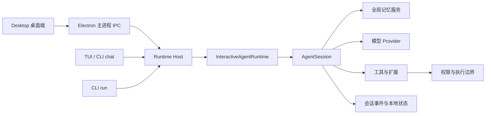

# 架构

Biny 遵循「本地优先（Local-first）」与「记忆优先（Memory-first）」的设计原则，将用户交互入口、执行核心与持久化存储严格解耦：
- **客户端入口**：Desktop 桌面端、终端 TUI 与 CLI 负责用户交互与事件呈现。
- **Runtime Host**：本机后台进程，管理会话准入、执行租约与任务生命周期。
- **AgentSession**：承载单会话的模型上下文装配、提示词生成与工具循环。
- **本地存储**：Session JSONL 保存不可变历史事实，SQLite 维护长期记忆、活动记录与查询索引。

## 执行链路

### 本地 IPC 与连接就绪

- **跨平台通道**：macOS / Linux 采用 Unix Domain Socket 通信，Windows 采用具名管道（Named Pipe，严格限制为当前用户与 SYSTEM 独占访问）。
- **初始化与就绪门禁**：Host 启动后发布 `initializing` 状态，客户端调用 `waitForReady()` 等待事件与快照同步就绪（最长 60 秒），防止把新消息发送给未准备好的环境。
- **Host 生命周期管理**：
  * 同项目下的会话共用同一个 Host，初始化时自动复用已有进程。
  * 最后一个交互客户端断开后，若无在途任务或保活工作，Host 在 30 秒空闲宽限期后自动安全退出。

## 目录与职责划分

| 核心目录 | 实际职责与设计边界 |
| --- | --- |
| [`src/desktop/`](../src/desktop/) | Electron 主进程、渲染层、本地 IPC 通信与 macOS 原生窗口集成。 |
| [`src/tui/`](../src/tui/) | 终端交互界面：键盘导航、Thinking 状态动效与事件流渲染（基于 Pi-TUI，无 React/Ink）。 |
| [`src/cli/`](../src/cli/) | 命令行参数解析、子命令路由与无界面批处理执行入口。 |
| [`src/agent/`](../src/agent/) | Agent 核心循环：上下文组装、提示词工程、大模型调用与工具编排。 |
| [`src/runtime/`](../src/runtime/) | Runtime Host 守护、会话执行器、TaskRun 尝试、任务依赖图与定时调度。 |
| [`src/session/`](../src/session/) | 会话事件流持久化、分支管理、全文检索与会话导入导出。 |
| [`src/llm/`](../src/llm/) | 模型服务商适配（OpenAI / Gemini / Anthropic / DeepSeek）、Profile 目录与价格计量。 |
| [`src/extensions/`](../src/extensions/) | 扩展机制：MCP 协议客户端、Skills 技能包、Plugins 插件及子代理调度。 |
| [`src/permission/`](../src/permission/) | 工具执行准入、路径检查、敏感拦截与交互审批决策。 |
| [`src/computer/`](../src/computer/) | macOS 原生应用观察与控制：Accessibility 树遍历、局部事件模拟与画中画镜像。 |

* **展示与事实分离**：前端界面负责呈现与交互适配，不将自身的临时视觉状态作为落盘事实；核心业务逻辑均归属于可独立单测的核心模块。

## 状态保存

| 数据类别 | 权威事实来源与用途 |
| --- | --- |
| **对话与工具历史** | `Session JSONL`：记录用户消息、助手回答、工具调用、工具返回值与报错事件。 |
| **回合断点与写入权** | 会话租约与 Runtime 检查点：保障单会话唯一写入者约束，提供精确中断恢复。 |
| **长任务与依赖图** | Runtime Authority SQLite 状态：关联 Run、Attempt、Claim 与验证凭据。 |
| **会话目录与元数据** | `Catalog`：管理会话标题、置顶、归档与分支父子指针。 |
| **长期记忆与活动记录** | 全局 `agent.sqlite`：存储长期事实、用户档案、活动分析；向量与全文索引属于派生缓存。 |
| **全局与项目配置** | `config.json` 与 `.biny/settings.json`；凭据正文存放于系统 Keychain 或独立安全存储。 |

- **界面偏好事务**：桌面端外观偏好（主题、字体）由 `DesktopStateStore` 串行更新并持久化，回归测试见 [desktop-state-preference-publication.test.ts](../tests/desktop-state-preference-publication.test.ts)。
- **存储路径约定**：全局配置默认保存在 `~/.config/biny/`，项目运行时数据存放在 `~/.biny/agent/`，详细配置见 [模型与配置](CONFIGURATION.md)。

## 恢复与外部副作用处理

- **确定性与未知结果**：恢复流程优先读取已确认的工具结果；对于已派发但未收到明确回执的外部写操作，在缺少确定性证据时保持未知并停止，绝不盲目重复重放。
- **只读查询不唤起 Agent**：浏览已有历史、任务进度或目标状态均通过本地持久化投影直接读取，不触发额外的大模型调用或启动新回合。

## 模型与扩展边界

- **多层解耦**：Provider 别名、Biny 模型别名与远端真实 Model ID 三层分离，元数据不覆盖用户自定义的端点和凭据配置。
- **扩展隔离保证**：MCP 属于协议级跨进程边界，Plugin 属于进程内代码边界，Skill 属于提示词与静态资源边界，三者共用统一的工具准入与执行审计。
- **操作预览与实际事实**：浏览器与 Computer Use 的实时监督画面属于临时视觉反馈，不作为模型视觉观察或动作完成的终态证据。

## 跨平台边界

- **Shell 检测**：Windows 环境下依次探测 PowerShell 7、Windows PowerShell 5.1 与 cmd。
- **系统特有功能**：原生应用控制、桌面 Activity 采集、原生日历读取与 LaunchAgent 守护进程限定于 macOS。

## 继续阅读

- [会话与恢复](SESSIONS.md) — 历史事件流、分支管理、导入导出与断点续跑。
- [工具与权限](PERMISSIONS.md) — 权限模式、沙箱隔离、应用授权与命令准入。
- [目标与自动化](AUTOMATION.md) — 持续目标、任务尝试、依赖图与定时调度。
- [贡献指南](../CONTRIBUTING.md) — 仓库开发环境搭建、架构分层与测试规范。
