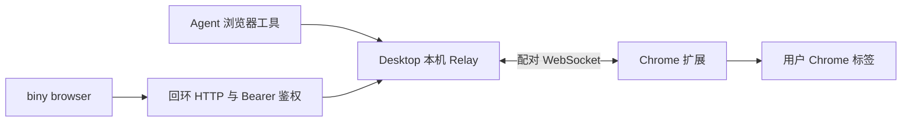

# 浏览器

Biny 提供内置浏览器与 Chrome Relay。内置页面适合新的网页任务和项目预览；Chrome Relay 连接用户的 Chrome 配置，保留其登录态，可读取和操作已有标签，也可在该配置中打开新页面。

## 页面由谁执行

内置浏览器由 Desktop 的浏览器执行端管理页面。Agent 将打开、读取和交互请求交给执行端，执行端返回页面文字、定位信息或动作结果；页面的登录态属于内置浏览器自身。`BrowserTabFloat` 可将当前会话拥有的标签显示在置顶窗口或收回工作区；浮窗承载同一可交互页面，操作时避免与 Agent 并发输入。

Chrome Relay 的链路是：



Relay 管理配对连接与请求，扩展在目标 Chrome 配置中读取或操作标签，网页继续使用该配置已有的登录态。连接描述保存到全局运行目录的私有 `browser-relay.json`；配对地址用于扩展连接，CLI 用其中的端口和令牌访问本机 HTTP 入口。服务运行、扩展连接和目标标签可用是三个不同状态。

每次扩展连接分配新的 `browserId`，标签使用该连接下的 `tabId`。请求在派发前校验参数与连接，返回后校验结果；同一连接同时只接受一项在途请求。超时、取消或断线后，已派发的修改可能返回 `unknown`，连接恢复不会重发动作。

读取返回页面内容与定位信息，交互只对当前目标执行。iframe 的 `frameId`、`documentId` 进一步限定文档身份；页面导航后旧引用不能继续代表新文档。监督画面是临时预览，不更新这些操作引用，也不证明网页提交完成。

## 选择入口

| 任务 | 入口 |
| --- | --- |
| 找资料或读取公开网页 | `WebSearch`、`WebFetch`。 |
| 在 Biny 中打开页面、检查本地预览 | `BrowserOpen`、`BrowserReadDom` 和后续交互工具。 |
| 使用日常 Chrome 标签或已有登录态 | Chrome Relay。 |

两种浏览器有各自的标签和登录态。导入 Cookie 不等于连接已有标签，内置浏览器也不能用来报告用户日常 Chrome 的当前状态。

终端中的 `biny iab` 操作 Biny 内置浏览器，依赖正在运行的 Desktop；`biny browser` 仍用于 Chrome Relay。`iab envs` 列出登录环境，`iab goto <url> --env <name>` 在指定环境打开页面，`iab info` 读取当前页面，`iab fetch <url...> --env <name>` 抓取登录态页面。`iab click <selector>` 点击控件，`iab fill <selector> <value>` 替换输入值，`iab press <key> --selector <selector>` 聚焦控件并发送按键，省略 selector 时向当前焦点发送按键。抓取默认返回可读正文，传 `--html` 返回 HTML，传 `--json` 返回结构化结果。直接调用 CLI 由用户发起，不经过模型工具审批。命令示例见 [CLI 使用指南](CLI_USAGE.md#内置浏览器)。

`iab status` 查看页面状态且不创建首页；`back/forward/reload` 等待导航结果，失败不会当作成功页面返回。`history` 读取当前标签的导航栈，`profile history` 查询本机浏览器配置中的访问记录，二者数据来源不同。`scroll` 按像素滚动，`screenshot` 将可见视口保存为 PNG。`tab list/new/select/close/stop/float` 使用登记项目的同一标签集合；默认按当前目录匹配项目，也可传 `--project`，选中标签后页面操作使用该标签。

`eval/cdp` 提供当前页面的 JavaScript 与原始 CDP 操作；`viewport set/reset` 控制视口模拟，`--mobile` 同时启用触控输入。Agent 的 `BrowserCDP` 可调用当前页面支持的 CDP 命令，按关键风险进入统一权限审批和执行审计；ask/auto 模式需要逐次批准，full-access 模式跳过交互确认。参数上限为 16 KiB，可能访问敏感页面数据、本机文件或产生远端副作用。命令参数与结果只提供给当前模型调用，不写入持久会话、恢复点或工具事件。`biny iab cdp` 是用户直接调用的 CLI；Agent 不得借 Shell/CLI 绕过 BrowserCDP 的权限链。`upload/download/export` 与 Chrome Relay 共享工作区文件读写边界和 8 MiB 传输限制，不建立另一套文件权限规则；导出支持 PDF、HTML、MHTML 和正文 Markdown。`download-media <selector> --out <path>` 保存页面中的图片、音视频、source 或链接；HTTP(S) 媒体经当前环境下载，页面创建的 blob 媒体在页面内读取。`export-gsuite <format> --out <path>` 按当前 Google 文档、表格或演示文稿导出其支持的格式。`dialog watch/get/accept/dismiss/stop` 在 Desktop 中维护每页的弹窗监听，弹窗控制可在等待中的页面执行之外响应；`dialog auto accept/dismiss/stop` 可在显式授权后自动处理当前文档后续弹窗，主页面导航或关闭会撤销策略。页面关闭或停止监听后移除自身事件监听器。`clipboard read/write` 操作系统剪贴板文本；Agent 工具还可在用户明确要求时把剪贴板图片作为本轮模型图片返回。参数与文件保存方式见使用指南。

`iab env create/update/delete/clear/import-cookies` 复用 Desktop 环境与 Cookie 服务；默认环境的限制、代理校验和运行门禁继续生效。`iab profile list/import` 使用已有的本机浏览器配置导入路径，导入目标为默认环境。`iab profile history <profile-id> [--query <text>] [--limit <count>]` 只读指定配置最近的访问 URL、标题和时间；仅在用户明确要求查看本机浏览历史时查询，并先通过 `profile list` 让用户指定配置。Agent 工具沿用 Biny 权限审批；该查询不读取网页正文，目前支持 macOS 的 Chrome 系浏览器配置。环境文件、数据清理范围和命令示例统一见使用指南。

`iab goto` 显式指定 `--env default` 或 `--env 默认` 时只使用默认环境，不会复用当前显示的其他账号或小红书专用标签；未指定环境时仍延续当前显示的内置标签。

内置浏览器的“环境”用于并排使用不同账号。每个环境单独保存 Cookie 和网页存储，标签会显示环境颜色；默认环境继续使用现有的内置浏览器登录态。用户可在浏览器环境菜单中新建、改名、设置代理、导入默认环境 Cookie、清空或删除自定义环境。默认环境不能通过环境菜单清空或删除。删除开始时会关闭该环境的页面，并拒绝新建或重新打开该环境的页面；此前尚未完成环境准备的请求也不能在删除后重新打开它。若清理失败，环境保留供用户重试。环境设置保存在本机 Desktop 用户数据中。

保存环境期间，名称和代理表单暂时不可编辑，避免保存完成时丢失等待期间输入的改动。表单未关闭时，保存失败会保留已提交的草稿并恢复编辑，方便修正后重试；主动关闭菜单不会取消已发起的保存。

Agent 可通过 `BrowserListEnvironments` 查看已有环境，并在用户指定账号或任务需要特定登录时，将环境名称传给 `BrowserOpen` 或 `WebFetch`。未指定时，`BrowserOpen` 延续当前内置标签的环境；没有当前标签时使用默认环境。`WebFetch` 默认使用默认环境。Agent 不能新建、修改、清空、导入或删除环境。

Desktop 浏览器面板首次打开当前项目时检查预览入口。切回窗口或再次打开面板会保留检查结果；在外部新增 HTML 页面或修改项目启动脚本后，点击“运行预览”旁的“重新检查预览入口”按钮更新结果。没有入口或检查失败时也可通过该按钮重试。

## 连接 Chrome

1. 启动 Biny Desktop，在设置中打开浏览器页面。
2. 获取扩展安装目录。CLI 也可运行 `biny browser setup --json`。
3. 在 Chrome 的 `chrome://extensions/` 开启开发者模式，通过“加载已解压的扩展程序”加载该目录。
4. 从 Biny 浏览器设置复制配对地址，粘贴到扩展设置，保存并连接。
5. 在 Biny 中检查连接状态和标签列表。

配对地址含有连接信息，保留在自己的设备与扩展设置中，不放入公共文档或聊天日志。

## 列出与读取标签

```bash
biny browser status --json
biny browser tabs --json
biny browser open <browser-id> https://example.com/ --json
biny browser read <browser-id> <tab-id> --json
biny browser back <browser-id> <tab-id> --json
biny browser forward <browser-id> <tab-id> --json
```

标签按 `browserId` 分组。最多连接 8 个配对的 Chrome 配置，不同配置中的同号标签不是同一个目标。多个窗口各自可能有活动标签，不能把一个 `active` 标记直接当作唯一前台窗口。

`open` 在指定 Chrome 配置中打开一个 HTTP(S) 地址，等待该地址提交后返回新标签 ID，最多等待 8 秒；之后先读取该标签再操作。`back` 与 `forward` 只在历史目标仍为普通 HTTP(S) 页面时切换，并等待目标历史项成为当前项后返回；它们不等待完整加载。没有可用的网页历史时保留当前页。

读取后使用返回的真实 selector 和目标 ID：

```bash
biny browser click <browser-id> <tab-id> '<selector>' --json
biny browser fill <browser-id> <tab-id> '<selector>' '查询文本' --json
biny browser press <browser-id> <tab-id> Enter --json
```

重连会更换浏览器 ID；导航或框架更换也会使旧引用失效。重新列举和读取，不猜测新的 ID。操作后读取页面确认目标结果；成功发出点击不证明远端保存或提交已经完成。

## 截图、等待与文件

内置浏览器的 `BrowserScreenshot` 与 Chrome 的 `ChromeRelayScreenshot` 都可直接返回模型可查看的画面，默认不导出图片文件。仅在需要保留产物时提供 `path`，将原始 PNG 保存到当前工作区；父目录必须存在，已有文件不覆盖，单图不超过 8 MiB。模型收到的是最长适配到 1280×1600、最大 1 MiB 的 JPEG，细小文字应分段观察。`imageReturned: false` 表示没有成功把图片交给模型，不能据此声称完成视觉检查。

两种入口均支持 `fullPage: true`。整页 CSS 尺寸超过 8192×16000 的任一边或 3200 万像素时拒绝，需分段截图。普通截图只取当前视口。截图不会自动点击、滚动或触发持续监督预览。

`biny iab screenshot --json` 默认写入系统临时目录下独立的 `biny-browser-*/screenshot.png`，返回实际路径；`--full-page` 截取整页，`--out page.png` 保存为工作区内的新文件。临时文件不会在命令退出时删除，可由用户或系统后续清理。Chrome CLI 的 `act screenshot` 仍需显式提供工作区 `path`。

监督预览帧只用于界面展示，不作为模型截图落盘。显式工具截图的图片内容会随规范工具消息保存在 `~/.biny/agent/sessions/<项目分区>/<会话 ID>.jsonl`；配置 `BINY_AGENT_DIR` 时跟随该目录。每次模型请求只保留最近两张观察图、总量最多 2 MiB，历史会话记录不因此删除。使用配置的视觉模型时也先限制观察图，再生成图片描述。图片需要具备视觉能力的模型或已配置的视觉模型才能解释。

`biny browser act <method> --args '<JSON>' --json` 提供结构化入口，支持开新标签、页面读取、表达式执行、导航历史、截图、滚动、等待、上传和下载。Agent 调用 `ChromeRelayEval` 会按关键风险进入统一权限策略；直接运行 CLI 是用户发起的调用，不经过 Agent 工具审批。

文件使用当前工作区相对路径。截图与下载保存为新文件，目录应已存在；上传需要实际文件 input，设置文件后网站可能立即传输。iframe 操作需要读取结果中的当前 `frameId` 与 `documentId`，不跨导航复用框架引用。

Chrome 确认框由用户手动处理。`ChromeRelayEval` 可在用户已有 Chrome 页面执行不超过 10,000 字符的表达式，等待上限为 8 秒，返回值上限为 100,000 字符；Agent 调用被标记为关键风险并按当前权限模式处理，auto 模式逐次询问，full-access 模式遵循其免确认设置。表达式、结果和页面异常详情不写入会话与工具事件。Relay 不提供原始 CDP，也不能绕过站点权限、CORS 或系统保存框。具体参数见 `biny browser act --help` 和 [Relay 协议](../src/browser/relayProtocol.ts)。

## 内置浏览器的范围

自动处理页面对话框必须有用户对接受或取消结果的明确授权。授权只对当前文档有效，主页面导航或标签关闭后失效；操作完成后应主动停止。提示框回复不会出现在工具详情中，工具参数及中断回合检查点里的回复文本会脱敏。

Agent 使用 `BrowserOpen` 打开页面，通过 `BrowserReadDom` 读取文字和 selector，再使用点击、输入、按键、选择和勾选工具。模型会话的导航在自己的标签中进行，保留用户正在浏览的页面。选择器支持 CSS、`role=button|Exact name`、`label=Exact label`、`placeholder=Exact placeholder`、`text=Exact text`、`testid=identifier` 与开放 Shadow DOM 的 `host >>> child` 路径。点击、输入、选择和勾选要求唯一、可见、可用且稳定的元素，并检查遮挡；`BrowserWait` 最多等待八秒，可等待元素状态或文档加载。`BrowserBack`、`BrowserForward`、`BrowserReload` 和 `BrowserScroll` 支持常用页面移动；`BrowserViewport` 可设置或重置桌面/移动视口，移动模式也启用触控模拟。`BrowserEval` 可在内置页面执行 JavaScript 表达式，可能改变远端状态，优先使用结构化工具。`BrowserDialogStatus` 只观察页面对话框，`BrowserDialogRespond` 可接受或取消当前对话框，须有用户授权；`BrowserClose` 只关闭当前 Agent 会话拥有的标签。每次交互后重新读取确认。

`BrowserClipboardRead` 和 `BrowserClipboardWrite` 操作系统剪贴板，不操作网页内部剪贴板。只在用户明确要求时调用；Agent 工具调用遵循 Biny 权限审批。文本读取最多返回 20,000 个字符并标记是否截断，写入上限为 100,000 个字符。用户要求检查图片时，读取工具可把最多 1 MiB 的 JPEG 作为模型图片返回；不写成文件。剪贴板文本、图片和写入文本不会进入已保存的会话历史及恢复检查点。

Agent 的 `BrowserCDP` 可调用当前页面支持的 CDP 命令，参数不超过 16 KiB，并按关键风险通过统一权限审批；确认前的拒绝不会派发，派发后的取消、超时或断连按副作用未知处理。方法与参数会保留在当轮模型上下文，参数和结果在会话、恢复点及工具事件中脱敏。CDP 本身可访问敏感页面数据、文件或网络能力，只有在具体命令确有需要时才使用；优先使用具备工作区路径与文件大小约束的结构化工具。

`BrowserUpload` 可通过唯一 file input 上传已授权的工作区文件，单次总量最多 8 MiB；网站可能在设置文件后立即上传。`BrowserDownload` 可下载 HTTP(S) URL，或按唯一 selector 下载当前页的图片、音视频、source 或链接。页面创建的 blob 媒体在当前页读取；HTTP(S) 资源使用当前环境的登录态。`BrowserExport` 支持当前页 PDF、HTML、MHTML、Markdown，以及 Google Docs、Sheets、Slides 和 Drawings 各自支持的导出格式。每项最多 8 MiB，均按新建方式写入工作区；上传、下载和导出都需显式提供项目内路径，已有文件不会被覆盖。

`BrowserExport` 使用 `google-` 前缀区分 Google Workspace 格式；`biny iab export-gsuite` 使用不带前缀的格式名：

| 页面 | 格式 |
| --- | --- |
| Google 文档 | `google-pdf`、`google-docx`、`google-odt`、`google-rtf`、`google-txt`、`google-html`、`google-epub`、`google-md` |
| Google 表格 | `google-xlsx`、`google-ods`、`google-csv`、`google-tsv`、`google-pdf` |
| Google 幻灯片 | `google-pptx`、`google-odp`、`google-pdf`、`google-txt` |
| Google Drawings | `google-png`、`google-svg`、`google-pdf`、`google-jpeg` |

一次 `BrowserPress` 固定使用开始执行时选中的页面：定位、按下、释放与返回的页面状态不会因等待期间切换标签或环境而转移。页面关闭后不会改向其他标签；新的独立请求仍使用用户最新选择的页面。取消会阻止尚未派发的按下动作，已成功派发的按下仍尝试在原页面释放；这不保证撤销已经发生的网页效果，也不固定同一标签内导航前的文档。实现与回归入口为 `DesktopBrowserService.press` 和 `tests/browser-press-cancellation.test.ts`。

`BrowserOpen` 返回本次实际导航页面的 URL 与标题。等待加载期间切换标签或环境，不会把返回结果改成新选中的页面，也不会在加载结束后把后续操作切回旧页面；新的独立请求仍使用最新选择。导航页面关闭或加载失败时报告失败，不借其他标签代替结果。这个约束固定页面身份，不固定同一标签内的文档版本。实现与回归入口为 `DesktopBrowserService.executeAutomation` 和 `tests/browser-navigation-ownership.test.ts`。

操作成功后加入监督预览的来源保留最近一次完成的导航或输入所用页面，不随等待期间选择的新标签改换来源；“返回聊天”保留请求原有的项目和会话。预览失败不改写已完成的操作结果，来源页面关闭后也不以其他页面代替。实时画面不是动作完成时的历史截图，不能证明网页业务已经提交。

`BrowserScreenshot` 绑定请求项目的当前页面，截图期间切换可见标签不会把画面换到其他项目。项目没有页面时明确失败；关闭目标页面或取消请求后，不返回迟到截图，也不改用其他页面。截图沿用 `tool_call`、`tool_result` 执行事件，原始图片不塞入普通审计结果；文件保存受统一路径权限约束。

`BrowserLocatorRead` 与 `BrowserLocatorAction` 支持链式定位：`locator`、`getByRole`、`getByText`、`getByLabel`、`getByPlaceholder`、`getByTestId`，以及 `first`、`last`、`nth`、`filter({hasText})` 和 `visible`。只读动作提供 `count`、文本、属性、可见/启用状态、矩形和 `waitFor`；页面动作提供 click、double-click、fill、type、press、check、uncheck 和 selectOption。会改变网页的动作必须唯一匹配；存在重复目标时先用 `count` 检查，再明确选择 first、last 或 nth。CLI 接受同一 JSON 结构：

```bash
biny iab locator '{"steps":[{"m":"getByRole","role":"button","name":"Save"},{"m":"nth","index":1}],"action":{"m":"click"}}' --json
biny iab locator '{"steps":[{"m":"getByText","text":"Saved"}],"action":{"m":"textContent"}}' --json
```

`BrowserDOMSnapshot` 为视口内可交互元素生成短期 `ref`，并返回对应的 `snapshotId`。`BrowserDOMAction` 执行 click、type 或 press 后会让该快照失效；主页面开始导航、目标标签变化或目标几何/可访问名称改变时，引用也会被拒绝。页面更新后重新获取快照。`BrowserCUA` 支持鼠标点击、双击、移动、滚动、当前焦点输入文本和组合键；坐标使用视口 CSS 像素，执行端检查视口范围，并在输入失败时尝试释放鼠标或按键。

CLI 示例：

```bash
biny iab dom-snapshot --json
biny iab dom-action '{"snapshotId":"<snapshot-id>","ref":"e2","action":{"m":"click"}}' --json
biny iab cua '{"action":"click","x":320,"y":210}' --json
biny iab cua '{"action":"keypress","key":"c","modifiers":["Control"]}' --json
```

内置 `Browser*` 使用同一个浏览器界面中的多个隔离环境，不提供独立浏览器窗口池。Chrome Relay 另支持跨 iframe 与封闭 Shadow DOM 的定位；内置浏览器的语义定位覆盖主文档与开放 Shadow DOM。Desktop 浏览器执行端不可用时，不能把网页搜索或 Chrome Relay 声称为同一个页面。

## 可选外部并行浏览器

Browser Skill 可在需要独立并行浏览器进程或 Desktop 执行端不可用时，使用用户已安装且已运行的 PinchTab。Biny 不安装或启动该服务；没有可用服务时应说明缺少此后备能力。PinchTab CLI 经 Bash 执行，不经过 Biny Browser 工具审批链；每次操作仍须遵循用户授权，优先创建仅供当前任务使用的临时实例，并在结束时停止自己创建的实例。不要接管或停止其他实例，也不要使用 stealth 设置绕过站点访问挑战。官方命令以 [PinchTab 文档](https://github.com/pinchtab/pinchtab/tree/main/docs) 为准。

## 排查

| 现象 | 处理 |
| --- | --- |
| 未连接 | 检查 Desktop 是否运行、扩展是否加载及配对设置。 |
| 旧 ID 不存在 | 重新列出浏览器与标签。 |
| 目标不唯一或不可点击 | 重新读取并使用唯一、可见且可用的 selector。 |
| 操作超时或连接中断 | 检查页面是否已经发生操作，再决定下一步。 |
| 页面要求确认 | 由用户处理确认框后继续。 |

CLI 与模型工具使用相同浏览器连接，但直接 CLI 不经过模型工具审批。授权边界见 [工具与权限](PERMISSIONS.md)。

实现入口：[Relay 连接与请求](../src/browser/BrowserRelay.ts)、[CLI 连接客户端](../src/browser/relayClient.ts)、[请求与目标协议](../src/browser/relayProtocol.ts)。
