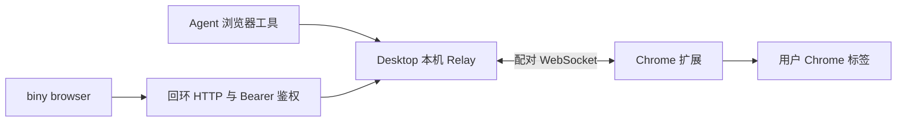

# 浏览器

Biny 提供两套互为补充的浏览器执行环境：
- **内置浏览器（Built-in Browser）**：由 Desktop 本地维护，适合新网页抓取、自动化操作与项目本地预览（支持多账号环境隔离）。
- **Chrome Relay**：连接用户日常运行的 Chrome 浏览器，复用其现有已登录标签页与扩展。

## 执行架构与运行链路

### 内置浏览器执行端

内置浏览器由 Desktop 内部的执行端管理。Agent 可通过工具向执行端发送导航、读取与交互请求，执行端返回文本正文、DOM 快照与定位引用：
- **首屏渲染观察（`BrowserOpen`）**：在 HTML 解析完成后即刻读取，正文和控件为空时最多等待 8 秒以捕获异步客户端渲染。默认返回至多 12,000 字符文本与可见控件短引用（`ref`）。
- **动态更新观察（`BrowserReadDom`）**：页面发生状态变化或需阅读更多正文时调用，支持通过 `maxCharacters` 扩展字符上限。
- **浮窗与交互（`BrowserTabFloat`）**：可将当前会话的标签页弹出为置顶独立浮窗或收回侧栏，便于人工观察与核验。

### Chrome Relay 连接链路



- **安全配对**：Relay 服务通过本机私有 `browser-relay.json` 管理配对，Chrome 扩展与 Desktop 间通过 WebSocket 加密通信。
- **身份标识**：扩展连接对应唯一 `browserId`，标签页对应 `tabId`。单连接同一时刻只承载一个在途请求，超时或断连时不自动盲目重放外部副作用。

## 选择入口速查

| 任务需求 | 推荐入口 | 核心特点 |
| --- | --- | --- |
| **检索资料或抓取公开静态网页** | `WebSearch`、`WebFetch` | 轻量快速，不启动图形化浏览器页面。 |
| **并发批量抓取（多 URL）** | `BrowserRead` | 一次最多处理 8 个网址，自动分配临时无界面标签并行提取。 |
| **在 Biny 内打开页面、填写表单、查看预览** | `BrowserOpen` / `BrowserReadDom` / `BrowserDOMAction` | 依托内置浏览器，支持 DOM 快照、Locator 语义定位与多账号环境。 |
| **操作用户当前已登录的日常 Chrome** | Chrome Relay（`biny browser`） | 复用用户真实浏览器的登录 Cookie 与会话。 |

* **终端 CLI 控制**：操作内置浏览器使用 `biny iab`，操作 Chrome Relay 使用 `biny browser`，命令示例详见 [CLI 使用指南](CLI_USAGE.md#内置浏览器)。

## 内置浏览器环境与多账号隔离

内置浏览器提供独立的「环境（Environment）」概念，用于多账号隔离与测试：
- **环境隔离**：每个环境独占 Cookie 与本地存储，标签页标有专属环境颜色；内置默认环境可直接使用。
- **环境管理**：支持在环境菜单中新建、更名、配置代理或清空自定义环境数据（默认环境受保护，不可删除或清空）。
- **Agent 调用绑定**：Agent 可通过 `BrowserListEnvironments` 查看已有环境并在 `BrowserOpen` 时指定；未指定时自动沿用当前标签的环境设置。

## 连接 Chrome 扩展（Chrome Relay）

1. 启动 Biny Desktop，在「设置 → 浏览器」中打开 Chrome Relay 页面。
2. 点击获取扩展目录，或在终端执行 `biny browser setup --json`。
3. 打开 Chrome 访问 `chrome://extensions/`，开启右上角「开发者模式」，点击「加载已解压的扩展程序」载入对应目录。
4. 从 Biny 复制配对连接串并填入扩展配置页，点击连接。
5. 在 Biny 侧栏核对 Chrome 标签列表与连接状态。

## 标签操作与语义定位

### 常用操作命令

```bash
biny browser status --json
biny browser tabs --json
biny browser open <browser-id> https://example.com/ --json
biny browser read <browser-id> <tab-id> --json
biny browser click <browser-id> <tab-id> '<selector>' --json
biny browser fill <browser-id> <tab-id> '<selector>' '查询文本' --json
biny browser press <browser-id> <tab-id> Enter --json
```

### 语义定位与 DOM 操作

- **链式 Locator（`BrowserLocatorRead` / `BrowserLocatorAction`）**：
  * 支持 `getByRole`、`getByText`、`getByLabel`、`getByPlaceholder`、`getByTestId` 等语义选择器。
  * 破坏性动作（如点击、输入、勾选）要求**唯一定位**；若有多个匹配项，须先用 `count` 确定数量，再通过 `first`、`last` 或 `nth` 精确指定。
- **DOM 快照与短引用（`BrowserDOMSnapshot` / `BrowserDOMAction`）**：
  * 为视口内可交互元素分配临时短引用（`ref`，如 `e2`）。
  * 执行点击或输入后快照自动失效，页面导航后需重新获取新快照。
- **直接坐标输入（`BrowserCUA`）**：基于当前视口 CSS 像素坐标模拟点击、双击、移动与按键，执行失败时会自动释放按压状态。

## 截图、等待与数据导出

- **屏幕截图（`BrowserScreenshot`）**：
  * 默认直接将图像数据交由大模型视觉解析（最长边等比缩放至 1600 像素，大小 ≤1 MiB），不额外写入磁盘。
  * 支持传 `path` 将原始 PNG 保存至工作区；支持 `fullPage: true` 截取整页（上限 3200 万像素）。
- **文件上传与下载**：
  * **上传（`BrowserUpload`）**：通过文件 input 控件上传工作区文件，单次总量限制 8 MiB。
  * **下载与导出（`BrowserExport`）**：支持将页面导出为 PDF、HTML、MHTML 或 Markdown；支持 Google Docs、Sheets、Slides 的原生格式导出，单文件上限 8 MiB。

## 弹窗处理与剪贴板

- **网页对话框（Alert / Confirm / Prompt）**：
  * 默认通过 `dialog watch` 监听弹窗状态；支持人工授权后通过 `dialog auto accept` / `dismiss` 自动化响应，主页面跳转后自动撤销授权。
- **系统剪贴板（`BrowserClipboardRead` / `BrowserClipboardWrite`）**：
  * 直接读写操作系统级剪贴板，严格遵循 Biny 权限审批，敏感文本不写入持久化聊天历史。

## 外部并行浏览器（PinchTab）

当需要多进程隔离或 Desktop 端不可用时，Browser Skill 支持调用本地已运行的 PinchTab 实例。PinchTab 独立于 Biny 运行，操作时应创建临时实例并在用后主动销毁，严禁绕过站点安全校验。

## 故障排查

| 常见问题 | 排查建议 |
| --- | --- |
| **提示 Chrome 未连接** | 检查 Desktop 是否常驻运行、Chrome 扩展是否启用以及配对密钥是否正确。 |
| **元素未找到或不可点击** | 重新调用 `BrowserReadDom` 或快照确认元素是否可见、被遮挡或在滚动视口外。 |
| **操作超时或返回 Unknown** | 网络慢或执行未决时，先重新读取页面以核对真实落盘状态，切勿盲目重复重放。 |

授权说明见 [工具与权限](PERMISSIONS.md)，底层实现见 [Relay 连接与请求](../src/browser/BrowserRelay.ts) 与 [请求与目标协议](../src/browser/relayProtocol.ts)。
