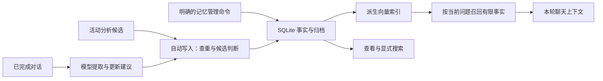

# 长期记忆

Biny 保存两类不同资料：会话历史记录当时发生的对话与工具操作，长期记忆保存适合以后使用的事实。修改一条记忆不会改写原始会话。

模型主动检索和保存事实使用 `biny memory search "查询" --json`、`biny memory add "事实" --json`，原始对话检索使用 `biny history search "关键词" --json`。搜索可用 `--limit` 设置结果条数（默认 20），用 `--threshold` 覆盖本次相似度阈值（0 至 1，省略时使用记忆设置）。这些命令通过 Shell 执行；自动召回与自动提取独立运行。普通追加允许在当前模型回合中执行，清理与整理仍要求会话空闲。

## 事实如何写入与使用



`MemoryStorage` 保存事实身份、正文、标签、重要度、来源锚点和归档关系。`LocalMemory` 只承载调用上下文中的模型提取与事实操作。全局 owner 装配 `MemoryMaintenance`，统一管理 Sleep、嵌入资源、进度和取消；会话关闭不取消维护。向量服务负责检索投影。事实写入和索引更新有各自结果；缺失索引时不能把事实库视为已经丢失。Activity 管线会在尝试其余候选后报告部分写入失败；分析结果保留，但不会自动重放这些写入。

自动贡献先从已完成对话或 Activity 分析中获取候选，再从同一用户范围检索相关事实，判断新增、更新或保持不变。例如已记住“后端偏好 Go，同时使用 pnpm”，用户明确改为偏好 Rust 时，模型可以更新原事实并保留 pnpm 这一未变的信息。更新保留事实 ID，旧正文和来源另存为 `updated` 归档，新旧版本在同一事务中提交；提交前检查旧事实版本，避免覆盖并发编辑。模型判断仍可能出错，归档提供核对和恢复依据。

自动写入要求同一用户范围内已有事实的向量索引完整且模型匹配；空范围可写入第一条事实。必需语义能力不可用、索引缺失或过期、模型响应非法或候选已被修改时，本次自动写入跳过，不把失败当作允许新增；聊天提取没有持久重试队列。提取结果同时含删除与新增时先处理新增，任一新增失败则保留本批待删除事实；本批已确认保留的事实不再删除。用户明确执行的添加与修改直接进入存储校验，不请求自动提取模型。

自动使用记忆发生在回合准备阶段：按当前问题查询可用语义结果，将有限事实加入上下文，而不是加载全部事实。贡献决定是否产生新记忆，使用决定是否自动召回，两个开关分别作用。Sleep 是独立维护过程，整理临时、重复和相似事实，并保留归档与维护记录。

Desktop 输入框的聊天记忆开关同时控制当前聊天的自动使用与贡献。切换只保存聊天偏好，不启动执行进程或加载模型；关闭后，后续消息不自动召回或提取长期记忆，也不做后台主题提取。重新开启不会补提取关闭期间的主题。已有聊天历史与记忆事实不会删除，显式查询和管理操作不受影响。

## 记忆的范围

长期事实使用全局本地记忆库，可跨项目使用。`threadId`、`userId` 和标签用于来源与查询筛选，不构成访问控制或独立租户隔离。

会话历史仍按项目保存。查找“当时具体说了什么”应搜索历史；查找“已经保存的偏好或约定”应搜索记忆。正文、来源时间和关联消息是不同信息，记忆写入时间不代表事实发生时间。

## 查看与搜索

```bash
biny memory list --json
biny memory stats --json
biny memory search "项目约定" --json
biny memory grep "原文片段" --json
```

`list` 默认展示最近更新的 100 条活动事实。`stats` 查看数量和维护状态。`search` 搜索长期事实；`grep` 在对话历史中进行字面匹配，保留查询中的标点语义。

可以按来源筛选：

```bash
biny memory search "部署" --thread-id <session-id> --json
biny memory search "偏好" --tag preference --json
```

语义搜索先按用户、会话和标签限定候选，再取相似度最高的有限结果，范围外事实不会占用名额。指定用户仍可检索未绑定用户的共享事实；筛选不构成身份认证。语义检索需要可用的 embedding，缺失索引或模型不匹配时，自动召回与显式语义搜索均返回空结果及降级原因。没有结果不能据此断言相关事实不存在于全部历史中。

默认使用本地 `Multilingual E5 Small`，也可选择 `All MiniLM L6 v2`。两者使用 Transformers.js / ONNX 生成 384 维向量，权重需要先在记忆设置中下载，安装后可离线检索。模型尚未下载时明确显示不可用，不自动把记忆发送到远端。查询改写和事实提取仍使用配置的辅助模型，因此整条对话链路不一定离线。

Desktop 的“记忆工具模型”可覆盖通用工具模型，留空则沿用当前默认工具模型。“测试模型”只验证发起请求时的模型配置；切换模型、继承的默认模型改变或该模型配置更新后，旧测试结果清除，迟到回执不会覆盖新选择的状态。切换后可直接测试新模型，不必等待旧测试结束。

Desktop 的“嵌入模型”选择器按本地模型与服务商分组，显示下载体积及可用状态。已有的显式模型选择保持不变；选择远端 Provider 或“自动选择可用服务商”时，查询和待索引事实会发送到对应服务。自动策略显示实际模型及“自动”标记，没有可用服务商时返回不可用。更换模型先确认，再保存设置并重建向量；原始事实保留，旧向量不能用于新模型检索。

## 添加与修正

```bash
biny memory add "项目开发命令使用 pnpm" --json
biny memory get <memory-id> --json
biny memory update <memory-id> --entry '{"content":"项目统一使用 pnpm 10.6.5"}' --json
```

明确的管理命令直接校验并写入事实，不经过自动提取模型。每次 `add` 可以创建独立条目；添加前先查询已有内容，避免把修正写成重复的新事实。`update` 的 `--entry` 必须是 JSON 对象；`null`、数组和其他非对象值会报错，不改变已存事实。

结构化输入可使用 `--entry` 指定标签、重要度等受支持字段。保存稳定且自包含的内容；不要把密钥、猜测或未确认的模型结论当作用户事实。

更新时若提供 `content`，它必须是非空白字符串；非法正文会明确报错，不修改事实或同次提交的其他字段。只调整标签、重要度等信息时可以省略 `content`。

## 归档、恢复与删除

```bash
biny memory archive-entry <memory-id> --yes --json
biny memory archived --json
biny memory restore <archive-id> --json
biny memory delete <memory-id> --yes --json
```

Desktop 搜索记忆时，按 Enter 开始查询；确认输入法候选不触发搜索。搜索完成前重复按 Enter 不重复发起同一查询，修改或清空查询后不展示旧结果。编辑记忆并保存后，保存期间继续输入的草稿会保留，可再次保存。

Desktop 记忆列表和归档列表按页读取，翻页不会重读全库统计。编辑、删除或归档条目后，列表保留当前页；末页被清空时退回仍有条目的最后一页。显式刷新会重新读取列表和统计。

普通归档使事实离开活动召回，仍可恢复；`updated` 归档保存自动更正前的正文，当前版本继续参与召回。恢复使用归档 ID 并创建独立事实，不覆盖仍存在的当前版本；Desktop 会显示当前版本供核对。永久删除活动记忆时，其 `updated` 历史一并删除，其他独立归档不受影响。

直接调用 Runtime Host 的 `archive` 操作时，`archived` 必须明确使用布尔值：`true` 归档，`false` 恢复；缺省、字符串或其他类型会被拒绝，不改变已保存的事实。

`memory archive` 是另一种操作：将会话 transcript 导出为本地 Markdown，不归档长期事实，也不删除会话。`memory clear --yes` 的缺省范围是整个共享事实库；按会话清理需要明确传入 `--thread-id`。执行前确认范围，不能把项目目录当作全局清空的边界。

## 自动处理

启用记忆贡献时，已完成对话可触发后台提取与更新。提取使用模型，可能遗漏或误判；成功的聊天终态也不证明自动记忆处理已经成功。带外部上下文的回合是否参与提取由记忆策略决定。

自动使用记忆与贡献记忆是不同设置。关闭自动处理后，用户明确发起的查询与管理命令仍可使用。Sleep 维护可以整理重复、临时或过期事实，但不会把模型判断变成独立验证证据。

## Sleep 巩固

Sleep、向量重建和模型下载由同一 Agent 数据目录的全局服务管理。不同工作区共享维护进度和取消入口，关闭聊天不会停止维护。手工编辑仍会核对当前事实版本。独立的 `memory serve` HTTP/WebSocket API 已移除，使用 `biny memory` 命令或 Desktop 设置管理。

默认在本地时间 03:00 后、运行时空闲时执行。启动时先识别上次中断的运行，5 秒后首次检查，之后每分钟检查；错过计划时间会在当天补跑。当天已有成功记录则跳过，连续三次失败后当天退避。恢复会启动新周期，不从某条 SQL 的中间继续。

处理顺序是精确去重、临时事实过期、向量聚类及模型合并，随后清理超过保留期的归档。默认 TTL 和归档保留期都是 30 天；明确的 `expiresAt` 到期可归档，否则 TTL 只作用于从未被召回的临时事实。永久事实不会仅因年限而过期。

相似度达到 0.75 时进入候选簇，达到 0.95 的直接重复候选可按保留优先级整理；带临时性或来源时间锚点的事实交给模型判断。默认每批最多 20 条，超过 50 条的簇整簇跳过，并在本轮阶段记录中保留跳过计数。整理按精确用户范围进行，共享事实与绑定用户的事实不互相归档。

模型只能提议保留、删除簇内 ID 或合成事实。合成正文为空、超长或格式错误时整批跳过；新事实及其向量确认可检索后，才在事务中复核来源和替代事实的版本并归档旧条目。任何合成或索引失败都保留来源，记录合成失败数。预览与执行使用同一套保留优先级。运行成功只表示维护流程完成，不能证明模型在语义上没有遗漏事实。

```bash
biny memory sleep
```

## 文件记忆与其他长期上下文

`USER.md` 保存用户资料，`MEMORY.md` 保存可读的长期内容，`memory/YYYY-MM-DD.md` 保存每日笔记。它们与 SQLite 的原子事实分别维护；文件内容不会自动镜像成事实条目。启用相关上下文时读取长期文件及今、昨笔记，缺失文件不因读取而创建。

时间线索负责日期和事件状态，活动记录保存桌面行为，会话摘要和项目建议组织跨会话主题。它们保留各自的来源和更新规则，按需提供上下文。日记反思、疲劳状态与 Memory Sleep 也是独立机制。活动采集与日记见[活动记录](ACTIVITY.md)，会话资料见[会话与恢复](SESSIONS.md)。

旧版本保存在 `agent.sqlite` 中的结晶数据不会被自动删除，但不再参与对话或提供管理与引用入口。旧配置中的结晶设置在读取时忽略，下一次保存配置时移除。

人格由默认提示词或用户的 `SOUL.md` 提供：存在有效 Soul 正文时使用中性基础指令和该正文，不再叠加默认人格。Soul 提示包含实际文件路径及完整成长规则，引导从兴趣、观点、表达和相处经历反思；成长写入由 `biny soul append-trait` 等入口执行，新增特质记录为 `- [YYYY-MM-DD] 描述`（UTC 日期），最多保留 15 条，新增时自动淘汰最早记录。每天最多自然成长一条是提示词建议，不拦截用户明确要求的同日修改；重复追加同一特质不会重复记录。自省使用同一个追加命令，兼容既有无日期特质，追加时保留核心正文和其他章节。

情绪同时呈现基础心情、当前会话心情及各自原因，默认表达偏好是好奇、略带俏皮和温暖。情绪与四级疲劳指引在每轮请求时注入，影响语气和回应方式，不进入固定人格前缀。清醒时可用 `biny fatigue` 查询、用 `biny sleep` / `biny wake` / `biny rest` 改变状态；睡眠、醒来和休息只改变疲劳，情绪能量只有在主观情绪能量独立变化时才更新。说“去睡了”本身不会修改持久状态，仍须实际执行命令。提示词装配和状态转换可确定性验证，具体模型的表达效果需要真实对话检验。

后台对话情绪分析要求模型返回仅含 `mood`、`valence`、`reason` 三个字段的 JSON 对象，最多生成 50 tokens。解析后的状态仍保存到 `emotions/context/<sessionId>.md`；这不是聊天正文的输出格式，也不需要迁移已有情绪文件。

## 日常人格与自省

启用用户资料后，缺少有效 `USER.md` 时会引导自然认识用户，逐步询问姓名、语言及当前平台所需的身份信息；已有回答直接使用，保存档案后不再重复引导。纯问候可结合已有活动分析回应，但不会把窗口停留或历史记录说成刚刚看见的行为。12 月 24 日当地时间 18:30 起至 25 日结束，闲聊问候可带圣诞表达；模型回复中的圣诞标记会在当前会话显示为 🎄 并触发轻量降雪效果；正常任务不增加节日开场。

`biny reflection run YYYY-MM-DD --json` 使用当前聊天模型和人格启动正常 Agent 回合，由 self-reflection Skill 指导它读取经历、写第一人称日记。`biny history day YYYY-MM-DD --json` 按消息发生的本地日期读取各会话的完整用户与助手正文，包含时间和来源；`biny emotion` 提供基础情绪与各会话的当前快照，快照不是当天的情绪历史。Skill 要求遵守 Activity 开关、将虚拟旅行标为想象经历，并将日记单独写入 `diary/YYYY-MM-DD.md`。

Agent 通过普通文件工具或 Bash 写日记，再按需执行 `biny memory add`、`biny soul append-trait`、`biny emotion set-base`。历史补写不改变当前人格或情绪，这是 Skill 的行为指引。没有专用自省模型、候选操作队列或恢复草稿，也不会自动把日记里的未来想法创建成任务。各次工具写入独立生效，后续失败不会回滚先前成功的步骤；重试时由 Agent 检查已完成的内容。

已有日期标记、独立日记或旧版自省分区时命令默认跳过，`--force` 要求重写；`--json` 只控制状态报告。未新增或改变日记时返回未写入，模型失败会报告失败。`biny diary refresh` 则是独立的聊天工作摘要入口，仍使用记忆模型与去重标记，不再串联人格自省。

多个工作区同时刷新同一天的聊天工作摘要时，先提交的「每日总结」会保留；其他刷新若发现该分区已不同于读取时的内容，返回 `written: false`、`reason: "superseded"`，可再次执行刷新。`--force` 只跳过去重，不覆盖这项并发检查。聊天摘要、活动记录和自我反思等其他分区仍各自保留；仅来源笔记在模型等待期间增加时，单次刷新仍可保存已读取的快照，不保证自动选择最新来源。

Heartbeat 仍默认关闭。开启后在配置的起止小时内运行，包含结束小时；默认 8–23 点包含 23:00–23:59。可在 `heartbeat.timezone` 设置 IANA 时区，活动窗口与每日提醒日期都按该时区计算；省略时使用运行机器的本地时区。首次心跳及其后每三小时会提示复查基础情绪。漏写日记和当日日记提醒每天各最多两次，提醒间隔至少 25 分钟；检测到独立日记、日期标记或旧版自省分区后停止提醒。普通日间笔记不算完成日记。心跳在独立会话中执行，普通检查使用工具模型，日记提醒使用当前主模型。任务巡检开始时读取承载它的 Runtime 当前前台会话清单，同时保留其他会话的未完成目标；切换或恢复前台会话不改变心跳自己的执行会话。

## 自拍与虚拟旅行

`biny selfie take "场景、衣着、表情"` 复用 `imageGen.model` 配置的生图服务商，并自动使用相册中最新的一张认可照片作为参考。相册为空时按完整外观描述生成；生成后不会自动入册，用户认可后再运行 `biny selfie save <path>`。`list`、`latest`、`count` 可查看相册。文件保存在全局配置目录的 `selfies/`；生成结果仍是独立的本地图片。自拍表情随当前情绪变化，外观以 Soul 为准。`biny selfie take --nsfw` 使用单独配置的 `imageGen.localModel`，服务地址必须是 loopback 上的 OpenAI 兼容图片 API，不会回退到普通模型；Agent 代执行时仅已验证主人的 Telegram 私聊 Session 可用。Telegram 桥接按配置的主人 ID 验证入站消息；图片命令生成的临时图片可发到获准的聊天，相册原图只可在主人明确请求时发到已验证主人的私聊，群聊及其他目标会被拒绝。

虚拟旅行通过 `biny travel go "京都"` 开始；`event "经历"` 记录事件及模拟花费，`advance` 推进虚拟天数，`mood "心情"` 更新状态，`home` 回家并归档。`status` 与 `history` 查看行程，`journal YYYY-MM-DD --text "日记"` 追加旅行日记，不带 `--text` 则读取。模拟预算起始为 800–1199，每个事件扣除 10–109；这不是实际消费或预订。

当前行程保存在全局配置目录的 `travels/status.json`，已完成行程保存在 `travels/history.json`；两份文件各自通过临时文件替换并受跨进程锁保护，读取时识别回家归档过程中的中断状态。旅行日记保存在 `travels/YYYY-MM-DD.md`。旧版 `travels/state.json` 会在下一次旅行状态变更时迁移。对话会读取旅行状态，回家后三天内可引用经历；开启的心跳可提示研究目的地、记录虚拟体验、推进或结束旅行，离家七天或预算不足 100 时建议返回。地点资料来自实际检索，虚拟经历不作为用户真实活动的事实。


## 存储与排查

记忆事实、归档和向量投影保存在本地 `agent.sqlite`，该数据库还承载 Activity 数据。向量可重建，事实和活动记录不能当作缓存删除。

事实库只接受当前版本或尚未创建事实表的新库，不自动升级历史结构；不兼容时拒绝打开并保留原库。检索异常先查看 `memory stats`、embedding 配置和服务状态，不通过删除数据库排障。

源码入口：[LocalMemory](../src/agent/context/LocalMemory.ts)、[记忆存储](../src/agent/context/memoryStorage.ts)。自动处理的模型选择见 [模型与配置](CONFIGURATION.md)。
