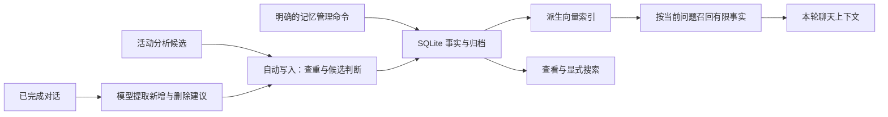

# 长期记忆

Biny 区分两类不同的持久化数据：
- **会话历史**：完整记录当时发生的原始对话与工具调用细节。
- **长期记忆**：沉淀并保存跨会话、跨项目复用的人格事实、用户约定与工作偏好。

修改或删除一条记忆不会改写原始会话历史；同样，会话归档也不会影响已沉淀的长期事实。

常用检索与管理命令：
- 检索记忆事实：`biny memory search "查询" --json`
- 写入明确事实：`biny memory add "事实" --json`
- 检索原始历史：`biny history search "关键词" --json`

搜索支持 `--limit` 设置返回数量（默认 20），以及 `--threshold` 设置相似度阈值（0 至 1，默认沿用记忆配置）。命令通过 Shell 直接执行；模型的主动追加可在当前回合内完成，而整库清理与 Sleep 维护则要求会话处于空闲状态。

## 事实如何写入与使用



### 核心组件职责

- **`MemoryStorage`**：负责事实 ID、正文、标签、重要度、来源锚点与归档关系的底层持久化。
- **`LocalMemory`**：在 Agent 执行上下文中承载模型事实提取、语义召回与操作调度。
- **全局维护进程**：装配 `MemoryMaintenance`，统一调度 Sleep 巩固、向量模型资源、维护进度与任务取消；单个会话窗口关闭不中断正在进行的维护。
- **向量检索服务**：负责构建和更新嵌入索引，提供相似度检索投影。事实存储与向量索引分立保存，索引缺失不代表事实数据丢失。Activity 分析管线若遇部分写入失败会如实报告，分析结果依然保留，不会盲目自动重放。

### 自动沉淀与去重机制

1. **候选提取**：自动记忆贡献从已完成的对话轮次或桌面 Activity 分析中提取事实候选。
2. **相关查重**：在同一用户范围内检索语义相关的既有事实，由模型对比判断是否属于重复信息。
3. **新增与更新**：
   - 包含实质新增信息的候选另存为独立事实，不静默覆盖旧条目。
   - 对话中的明确遗忘或纠错，由提取模型先提议删除旧条目，再新增替代事实。
   - 提交前核对候选事实版本，防止并发写入导致冲突；重复判断模型若失败或响应异常，系统默认保留并新增。
4. **前置条件**：自动写入要求当前用户范围内的向量索引完整且模型匹配（空范围可直接写入第一条）。若语义能力未就绪、索引缺失或候选已被并发修改，则延期写入。用户通过命令显式添加的内容直接入库，不依赖模型自动提取。

### Desktop 记忆策略控制

Desktop 输入框中的记忆开关可一键控制当前聊天的自动召回（使用）与自动沉淀（贡献）：
- **开关特性**：切换开关仅保存聊天偏好，不拉起后台进程或加载大模型。关闭后，后续消息不再自动召回或提取长期记忆，亦不做后台主题提取；重新开启不会补提关闭期间的主题。已有历史与记忆事实不受影响。
- **`/memories` 策略命令**：输入 `/memories` 可查看或调整当前会话的记忆策略，支持以下参数：
  - `off`：完全关闭当前聊天的记忆功能（不召回、不沉淀）。
  - `use`：仅自动召回既有记忆，不沉淀新事实。
  - `contribute`：仅自动沉淀新事实，不自动召回。
  - `both`：同时开启自动召回与自动沉淀。
  - `inherit`：跟随全局与项目的默认策略。
- **草稿与跨项目保留**：未发送草稿中的记忆选择随首条消息发送一并持久化；在窗口中切换项目时，各项目各自保留草稿的记忆偏好。
- **生效机制**：修改设置中的全局策略后，各项目在下一轮请求中自动读取，无需启动或重启 Runtime。

## 记忆的范围

- **全局共享库**：长期事实存储在全局本地 SQLite 库中，天然支持跨项目复用。
- **维度标签**：`threadId`、`userId` 与标签用于来源标识与查询过滤，不构成硬性多租户权限隔离。
- **记忆与历史的检索区分**：
  - 查找“当时对话具体说了什么”：使用 `biny history search` 检索会话历史。
  - 查找“已经沉淀的长期偏好或约定”：使用 `biny memory search` 检索长期记忆。
  - 正文、来源时间与关联消息相互独立，记忆写入时间不代表事实发生的时间。

## 查看与搜索

```bash
biny memory list --json
biny memory stats --json
biny memory search "项目约定" --json
biny memory grep "原文片段" --json
```

- `list`：展示最近更新的活动事实（默认 100 条）。
- `stats`：查看事实总数、向量索引与维护状态。
- `search`：执行语义与关键词搜索。
- `grep`：在对话历史中进行字面精确匹配，保留标点语义。

支持按来源或维度过滤：

```bash
biny memory search "部署" --thread-id <session-id> --json
biny memory search "偏好" --tag preference --json
```

### 嵌入模型与语义检索

语义检索先按用户、会话与标签限定候选范围，再按向量相似度返回最匹配的结果：
- **本地嵌入模型**：默认使用本地 `Multilingual E5 Small`，亦可选择 `All MiniLM L6 v2`。两者均基于 Transformers.js / ONNX 生成 384 维向量，模型权重需在 Desktop 记忆设置中下载，下载完成后可完全离线检索。未下载时明确显示不可用，不静默将文本发往云端。
- **云端服务商**：支持选择远端 Provider 或“自动选择可用服务商”，此时待索引文本与查询会发送至相应模型服务。更换嵌入模型需确认并重新生成全部向量投影，原始事实数据始终保留。
- **Desktop 模型配置**：
  - “记忆工具模型”：用于事实提取与合并，留空时沿用通用工具模型；“测试模型”即时校验当前模型配置。
  - “嵌入模型”选择器：按本地模型与服务商分组展示下载体积与可用状态，自动扫描并发现支持嵌入协议的模型候选。

## 添加与修正

```bash
biny memory add "项目开发命令使用 pnpm" --json
biny memory get <memory-id> --json
biny memory update <memory-id> --entry '{"content":"项目统一使用 pnpm 10.6.5"}' --json
```

- **显式添加**：`biny memory add` 直接写入事实库，不经过模型二次提取。建议在添加前先执行检索，避免重复录入。
- **结构化更新**：`update` 的 `--entry` 必须传入合法 JSON 对象，支持修改标签、重要度与正文。若提供 `content`，必须是非空白字符串；格式非法会明确报错并保护原数据不变。仅更新标签或重要度时可省略 `content`。
- **质量准则**：长期事实应当自包含、稳定且明确，严禁将未确认的模型猜测、临时密钥或敏感凭据写入长期记忆。

## 归档、恢复与删除

```bash
biny memory archive-entry <memory-id> --yes --json
biny memory archived --json
biny memory restore <archive-id> --json
biny memory delete <memory-id> --yes --json
```

- **归档机制**：
  - **普通归档**：将事实移出活动召回范围，仍可随时恢复。
  - **更新历史归档（`updated`）**：修改事实时自动保留旧版本记录，当前版本继续参与召回。
  - **恢复（`restore`）**：根据归档 ID 生成新的独立事实，不覆盖现存版本。
  - **永久删除（`delete`）**：彻底抹除活动事实及其关联合并历史，其他独立归档不受影响。
- **Desktop 界面交互**：
  - 搜索记忆时按 `Enter` 发起查询（输入法候选确认不会误触搜索），搜索中重复按 `Enter` 不重复发起。
  - 记忆与归档列表采用分页加载，单条编辑、删除或归档后保持在当前分页，末页清空时自动回退上一页。
- **操作区分注意**：
  - `biny memory archive-entry` 用于长期事实归档；
  - `biny memory archive` 则是将会话 transcript 导出为本地 Markdown 文档，不删除也不归档记忆事实；
  - `biny memory clear --yes` 默认清空全库，按会话清理须显式指定 `--thread-id`。

## 自动处理

开启记忆贡献后，每当会话成功结束一轮交互，系统会在后台从最近 4 条消息中分析事实：
- **消息合并**：工具调用与模型回复合并为单条助手记录，只抽取用户与助手的纯文本内容。
- **执行顺序**：每批先执行模型建议的删除操作，再写入新增事实，最后检查相关临时事实是否已过时。
- **查重对比**：新增事实前检索最多 5 条相似条目供模型对比；若语义运行时不可用或条目发生并发变动，系统将自动延期。各条操作彼此独立，单条失败不影响其余操作。

## Sleep 巩固

Sleep 是全局定时维护机制，负责在系统空闲时对事实库进行聚类、去重与清理。

```bash
biny memory sleep
```

### 运行机制与时机

- **执行时机**：默认在本地时间 `03:00` 之后、系统处于空闲时自动启动。服务每分钟巡检一次，错过计划时间会在当天自动补跑；当天已成功执行则跳过，连续失败 3 次后自动退避。
- **生命周期**：由全局独立进程维护，所有工作区共享进度。任务全部结束且无客户端连接后，空闲 30 秒自动退出；后续有需求时重新唤起。关闭当前聊天窗口不会中断维护。

### 4 步维护流程

1. **精确去重**：清除内容完全重复的冗余事实。
2. **临时事实过期**：检查 TTL（默认 30 天）与 `expiresAt` 标记，归档已过期的临时事实；永久事实不受年限影响。
3. **向量聚类与模型合并**：
   - 相似度达到 `0.75` 的事实聚类成候选簇，相似度达到 `0.95` 的候选按优先级直接整理。
   - 涉及时间锚点或上下文的事实交由模型判断；模型提议保留、删除或合成新事实。单簇默认最多处理 20 条，超过 50 条则整簇跳过并记录。
   - 合成内容格式错误或超长时整批跳过，原文在归档中完整保留并支持恢复。
4. **超期归档清理**：清理超过归档保留期（默认 30 天）的历史归档数据。

## 文件记忆与其他长期上下文

除 SQLite 事实库外，Biny 还支持通过本地 Markdown 文件维护更具叙述性的长期上下文。

### 长期上下文文件

- `USER.md`：记录用户个人画像、称呼与使用习惯。
- `MEMORY.md`：以 Markdown 形式保存用户或 Agent 沉淀的全局说明。
- `memory/YYYY-MM-DD.md`：按日期记录当天的临时工作笔记。

读取上下文时会自动加载长期文件及今、昨两天的笔记，文件缺失时不会自动创建空文件。

### 人格与成长（SOUL.md）

- **人格定义**：若存在有效的 `SOUL.md`，Agent 会结合基础中性指令与该文件正文，不再叠加默认人格预设。
- **成长特质沉淀**：通过 `biny soul append-trait` 等命令沉淀反思特质，格式记录为 `- [YYYY-MM-DD] 描述`（UTC 日期），最多保留 15 条，超额时按 FIFO 淘汰最早记录。追加同一特质不会重复落盘。

### 情绪与疲劳状态

- **状态表达**：每轮对话综合基础心情、当前会话心情与各自原因，默认呈现好奇、温和且带有适度俏皮的语气。
- **动态注入**：当前情绪与 4 级疲劳指引在请求模型时动态注入提示词，影响语气与回答风格，随消息独立落盘。
- **疲劳控制命令**：
  - 查询状态：`biny fatigue`
  - 调整状态：`biny sleep`（睡眠）、`biny wake`（唤醒）、`biny rest`（休息）。口头说“去睡了”不改变系统状态，必须执行命令。
- **后台情绪分析**：通过 5 秒防抖分析生成轻量情绪 JSON（`mood`, `valence`, `reason`）并保存于 `emotions/context/<sessionId>.md`。

## 日常人格与自省

### 新用户引导与节日彩蛋

- **自然引导**：未检测到有效 `USER.md` 时，Agent 会在对话中自然了解用户（姓名、语言与习惯），建立档案后不再重复询问。
- **节日彩蛋**：12 月 24 日 18:30 至 25 日 24:00 期间，闲聊问候会附带圣诞氛围（回复中包含 🎄 并在桌面端触发轻量降雪动效），正常工作任务不增加多余开场白。

### 每日自省与工作摘要

- **日常自省**：执行 `biny reflection run YYYY-MM-DD --json`，由 self-reflection Skill 指引 Agent 读取当天经历，以第一人称撰写日记并保存至 `diary/YYYY-MM-DD.md`。
- **聊天工作摘要**：执行 `biny diary refresh`，提取当天的聊天总结与工作产出。多工作区并发刷新时通过版本校验保护，后提交者不会覆盖先完成的总结。

### 定时心跳（Heartbeat）

- **运行窗口**：默认关闭。开启后在配置的起止时间内运行（默认 `8–23` 点，包含 23:00–23:59），支持通过 `heartbeat.timezone` 指定 IANA 时区。
- **巡检职责**：首次运行及后续每 3 小时提醒复查情绪；日记漏写提醒每天最多 2 次（间隔至少 25 分钟）。心跳按项目复用专属后台会话，不干扰前台聊天列表与置顶。

## 自拍与虚拟旅行

- **自拍相册**：
  - `biny selfie take "场景、衣着、表情"`：调用生图服务商生成自拍，自拍表情与当前情绪联动，外观以 Soul 设定为准。
  - `biny selfie save <path>`：经用户确认后将照片保存入册；通过 `list`、`latest`、`count` 查看相册。
  - 私聊与群聊权限：相册原图仅允许发送至获准的主人 Telegram 私聊，拒绝在群聊中分发。
- **虚拟旅行**：
  - 通过 `biny travel go "城市"` 开启旅程；`event` 记录模拟经历与虚拟开销，`advance` 推进天数，`mood` 记录游玩心情，`home` 结束行程并归档。
  - 旅行日记保存于 `travels/YYYY-MM-DD.md`，行程结束后 3 天内对话可自然提及旅行经历。

## 存储与排查

- **存储文件**：长期记忆事实、归档记录与向量投影均保存在本地 `agent.sqlite` 数据库中。
- **排查建议**：
  - 遇到检索异常，优先通过 `biny memory stats` 查看条目数量、向量索引完整度及 embedding 服务状态。
  - 严禁将删除 `agent.sqlite` 作为排障手段，该数据库同时承载重要的活动事实与历史沉淀。
  - 向量数据可在模型配置更新后重新生成，原始事实切勿随意清空。

源码入口：[LocalMemory](../src/agent/context/LocalMemory.ts)、[记忆存储](../src/agent/context/memoryStorage.ts)。模型配置与选择见 [模型与配置](CONFIGURATION.md)。
